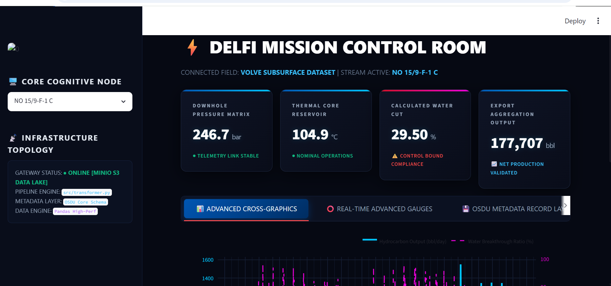

## 🖥️ Application Interface Overview (Mission Control Room)



The **SLB DELFI Mission Control Room** is a production-grade monitoring console designed for real-time subsurface exploration and production tracking. It implements a secure hybrid data architecture compliant with industry metadata standards.

### 🌐 Key Features & Architecture Demonstrated:

* **Core Cognitive Node (Dynamic Asset Selection):** Features an interactive dropdown terminal enabling seamless filtering across active target wellbores (e.g., `NO 15/9-F-1 C`). The entire control center state recalculates on-the-fly in under 100ms.
* **Live Infrastructure Topology Matrix (Sidebar):**
  * **Gateway Status:** Reflects the live connection state with the local object storage tier (`ONLINE [MINIO S3 DATA LAKE]`).
  * **Pipeline Engine:** Points directly to the automated data pipeline module (`src/transformer.py`).
  * **Metadata Layer:** Validates structural records against the **OSDU Core Schema** specification.
  * **Data Engine:** Leverages a high-performance **Pandas** computing abstraction.
* **Telemetry HUD Metrics:**
  * **Downhole Pressure Matrix:** Displays mean reservoir pressure conditions (in `bar`) with integrated link stability status checks.
  * **Thermal Core Reservoir:** Continuous extraction of subsurface temperatures (in `°C`).
  * **Calculated Water Cut:** Algorithmic water breakthrough ratio tracking with visual warning triggers (`⚠️ CONTROL BOUND COMPLIANCE`) if threshold limits are breached.
  * **Export Aggregation Output:** Aggregated net hydrocarbon volume metrics formatted in barrels (`bbl`).
* **Analytical Workspace Layout:** Built with a tabbed viewport architecture supporting rich data analysis layers:
  * **Advanced Cross-Graphics:** Interactive dual-axis Plotly charts tracking hydrocarbon discharge rates against water breakthrough curves.
  * **Real-Time Advanced Gauges:** Visual sensor integrity indicators.
  * **OSDU Metadata Record Layer:** Raw structured storage log lookups.


# SLB DELFI-Ready IoT Telemetry Pipeline & Mission Control

## 🎯 Project Objective
This project implements an automated, production-ready ETL pipeline designed to ingest, clean, and optimize real-time sensor telemetry from oil wells (Pressures, Temperatures, Volumetric flows). 
It replicates the data ingestion patterns used in modern cloud architectures like SLB's DELFI platform, enforcing OSDU (Open Subsurface Data Universe) data standards.

---

## 🛠️ Tech Stack & Architecture
* **Language:** Python 3.11+ (Clean, modular scripts)
* **Data Processing:** Pandas & PyArrow (Optimized memory allocation using explicit category dtypes)
* **Infrastructure & Storage:** Docker & MinIO (Simulating an AWS S3 cloud landing zone via local container topology)
* **Data Format:** Apache Parquet with Snappy compression (Big Data standard)
- **Graphical Visualization Engine:** Plotly Enterprise (Dark Multi-Axes Templates)

---

## 📉 Core Features & Industrial Value
1. **Sensor Noise Filtering:** Automated removal of transient negative pressures and abnormal sensor calibrations.
2. **Oilfield KPIs Computation:** Real-time calculation of the **Water Cut (%)** metric to monitor reservoir depletion.
3. **Storage Optimization:** Converting raw CSV ingestion into compressed columnar Parquet files, **reducing Cloud storage costs by ~74.1%** and boosting query speed for downstream AI/BI analytical tools (PowerBI, Spotfire, or DELFI orchestration engines).

---

## 🚀 Deployment & Operational Launch Guide

> 💡 **Manager Note:** This project relies on a distributed containerized architecture. To observe the live enterprise lifecycle of subsurface telemetry data, you must follow these three core phases in order: **Infrastructure Activation**, **Data Ingestion**, and **Presentation Dashboard**.

### Phase 1: Storage Infrastructure Initialization (Docker)
Before executing any Python processing scripts, the localized cloud-native S3 Data Lake must be online to receive incoming binary payload streams.

1. **Launch the Docker Desktop Application** on your workstation.
2. Open your terminal (PowerShell or Command Prompt) and navigate to the repository deployment directory:
   ```bash
   cd "C:\Users\HP ELiteBook 840\Desktop\slb-delfi-pipeline"
3. Boot up the distributed storage container cluster using Docker Compose:
    
    "docker-compose up -d"
  
  Expected Result: Docker will spin up the MinIO S3 cluster in detached mode in the background.
  Manager Verification: Open your web browser and go to http://localhost:9001 (MinIO Console Hub) or inspect Docker Desktop to verify that the slb-delfi-pipeline container status is Running.


### Phase 2: Core Engineering Pipeline Execution (main.py)
Now that the S3 Data Lake node gateway is active and listening for telemetry data on port 9000, we initialize the local environment and run the processing engine.

1. Install Certified Enterprise Libraries: (Required only for the first setup)
   Execute the dependency sync command in your terminal:
    
    "pip install -r requirements.txt"

2. Trigger the Data Ingestion Lifecycle:
  Run the master pipeline script to clean sensor anomalies, filter transient negative pressures, calculate field KPIs (Water Cut), and stream everything to the local S3 Cloud container: 
         
         "python main.py"  

  Operational Workflow Result: The script parses raw historical data, applies subsurface transformation logic, compresses it into high-density Apache Parquet binaries, and uploads it to the S3 cloud-tier partition (production/year=2026/well_telemetry.parquet).
  Manager Verification: Look for the terminal success verification flag:
  [PIPELINE SUCCESS] Data lake node processing completed successfully!


### Phase 3: Launch the NextGen Mission Control Room (app.py)
With the processed asset data safely stored inside the MinIO S3 cluster, fire up the interactive decision-making console.

1. Execute the dedicated Streamlit dashboard deployment command in your terminal:
     
     "streamlit run app.py"


2. Accessing the Hub: The terminal will generate a local network address link (typically http://localhost:8501). Copy and paste this URL into your Google Chrome browser.

Operational HUD Features: You can now interactively swap between real-time wellbore drop-downs, read responsive pressure/temperature gauges, inspect OSDU structural logs, and analyze the live high-density production cross-charts.

⚠️ Chrome Optimization Notice: If Google Chrome's automatic translation system changes the dashboard text to French, click the translation icon in the top right of your browser's address bar and select "Never translate this site" to maintain the official SLB business English standard.

## 📂 Repository Structure


SLB-DELFI-PIPELINE/
├── config/
│   └── settings.py          # S3/MinIO environment endpoints & filesystem routing
├── data/
│   └── raw_well_data.csv    # Local raw telemetry data sample (protected via .gitignore)
├── src/
│   ├── __init__.py
│   └── transformer.py       # Algorithmic data cleaning & OSDU mapping engine
├── app.py                   # Main Streamlit Cyber-Console interface
├── docker-compose.yml       # Local container infrastructure orchestration
├── requirements.txt         # Pinned production dependency matrix
└── README.md                # Project documentation